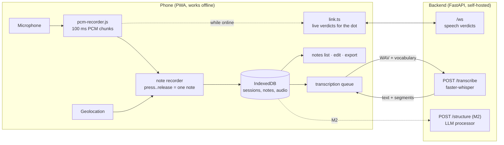

# RedDot Field Notes — Product Requirements

**Status:** draft v0.2 · 2026-10-28 (v0.1: 2026-10-17)
**Direction:** turn the RedDot voice-input testbed into a free, self-hostable voice field notebook, and on Android into a free replacement for Wispr Flow: dictation into any app.

---

## 1. Summary

RedDot Field Notes turns spoken observations into **timestamped, geotagged field notes**. Hold the red dot (or tap to toggle), say what you see, and the note is saved on the phone with the time and place, transcribed, and laid out in a field-note template. A second, optional AI step turns a session's notes into a structured report.

It borrows the core idea of Wispr Flow (speak, get clean text) but is deliberately narrower: a free, open-source app built for **working outside**: patchy or no signal, gloves, wind, sun glare, one free hand.

## 2. Starting point

The repo today is a working voice-input frontend (details in [README.md](README.md)):

- Push-to-talk red dot (mouse, touch, `R` key), drawn full-screen with WebGL.
- The browser streams 16 kHz PCM in 100 ms chunks over a WebSocket to a FastAPI backend, which judges each chunk (loudness + WebRTC VAD) and cuts the stream into utterances (200 ms of speech starts one, 700 ms of quiet or 15 s ends it).
- The browser keeps the audio. Each utterance becomes a wavy line you can tap to replay and drag around.

What is missing for field notes:

| Gap | Today | Needed |
|---|---|---|
| Persistence | Lines vanish on reload; at most 24 | Every note kept on the device until exported or deleted |
| Text | No transcription | A transcript per note |
| Time and place | Only the duration | Wall-clock timestamp and GPS for every note |
| Offline | Recording is refused when the backend is unreachable (`press()` needs an open WebSocket) | Recording always works; transcription catches up later |
| Note boundaries | Split at 0.7 s pauses and at 15 s | One press = one note (observations have pauses) |
| Output | None | Readable field notes; Markdown/CSV/JSON export; later, reports |
| Battery | Shader redraws at 60 fps all the time | Idle when nothing moves |

## 3. Problem and users

**Primary user:** someone doing fieldwork (ecological surveys, site inspections, sampling) who needs to record observations while their hands and eyes are busy. *(The exact kind of fieldwork is assumed; see [Open questions](#14-open-questions).)*

**Today's workarounds:**
- A paper or waterproof notebook: slow, hard with gloves, wet, or cold.
- Typing on a phone: needs two hands and attention.
- Voice memos: rarely transcribed, have no structure, and can't be searched.
- The result is that details get reconstructed from memory at the end of the day, with guessed times and locations.

**Jobs to be done:**
1. *When I see something, let me capture it in under 5 seconds without looking at the screen.*
2. *At the end of the day, give me my notes in order, with time and place, as text I can correct.*
3. *Turn those notes into the format my datasheet or report needs, without retyping.*

## 4. Goals and non-goals

**Goals**
- **G1 Never lose a note.** Audio is stored on the device the moment a press ends, before any network call and regardless of server or signal.
- **G2 Time and place on everything.** Every note has a timestamp and, when permission and a fix are available, a location.
- **G3 Transcripts you rarely need to fix.** That includes domain vocabulary such as species names, site codes and abbreviations.
- **G4 Output without lock-in.** Notes come out in a field-note template and export as Markdown, CSV and JSON.
- **G5 Free to run.** The core flow (capture → transcribe → export) uses open models on a self-hosted backend, with no paid API required.

**Non-goals (for now)**
- System-wide dictation on desktops. On Android it is now a goal (M0, below): a native app can do what a web page can't.
- Live captions while speaking.
- Accounts, teams, or sync between devices.
- Native iOS/Android apps. The app ships as a PWA first.

## 5. What we take from Wispr Flow

| Wispr Flow | RedDot Field Notes | When |
|---|---|---|
| Hold a key, speak, release → text | Hold the dot (or tap to toggle) → a note | M1 |
| Personal dictionary | Project vocabulary (species list, site names, abbreviations) fed to speech-to-text and the LLM | M1 (ASR), M2 (LLM) |
| AI cleanup: filler words, punctuation, formatting | Optional cleanup pass; the raw transcript is always kept | M2 |
| Formatting that adapts to context | Formatting driven by templates | M2–M3 |
| Voice commands for editing | A few field commands: "scratch that", "new site …" | M4 |
| Types into any app | The red dot appears next to any text field on Android (M0) | M0 |

## 6. Core flow

1. **Start a session** (a field visit). Enter a title, project, site and observer, prefilled from the last session. The start time and location are recorded.
2. **Capture.** Hold the dot, or tap to start and tap to stop. A vibration or short tone marks the start and the stop. The note appears in the list immediately with its time, its location and a "transcribing…" status.
3. **Transcribe.** When the backend is reachable, pending notes are transcribed oldest first. When it isn't, notes wait in a queue and a counter shows how many are waiting ("7 waiting").
4. **Review.** The notes are listed in time order. Tap a note to replay it, edit its text, tag it, or delete it.
5. **Export** the session as Markdown field notes (see the [template](#8-default-field-note-template)), as CSV (one row per note), as JSON (everything), or as audio files in a zip.
6. **Structure and report** *(M2/M3).* Run a template over the session, review the extracted fields, and export a report.

The red dot stays the capture control. The utterance lines become notes, and a notes panel (swipe up or tap a button) shows the list.

## 7. Requirements

Priority: **P0** = the milestone can't ship without it · **P1** = should have · **P2** = later.

### M0 — Android voice bubble (the Wispr Flow replacement)

The workflow it replaces: Wispr Flow on an Android phone. Tap into any text field, for example a Claude chat, tap the floating icon, speak, and the text appears; Claude then does the formatting. M0 does the same with RedDot's own server, and learns the user's words.

| ID | Requirement | Pri | Status (v0.1, branch `android-dictation`) |
|---|---|---|---|
| R50 | **Bubble in any app.** A native Android app (sideloaded, or from a private Google Play test where an employer's phone management blocks installs from outside the Play Store) shows the red dot while a text field has focus and the keyboard is open. An accessibility service draws it, because only those may see the focused field in another app and write into it. Before Android's setting opens, the app explains what the service sees and asks (Google Play's disclosure rule). | P0 | Done, tested with Google Messages and Gboard on Android 15 and 16 (emulator); not yet on a phone |
| R51 | **Push-to-talk and hands-free.** Hold the dot to talk and let go to stop, or tap to start and tap again to stop. One buzz at the start and two at the stop. Auto-stop after 5 minutes. | P0 | Done |
| R52 | **Text into the field.** The transcript goes in at the cursor, with spaces added where needed. If the field changed meanwhile, it goes to the clipboard. | P0 | Done (ACTION_SET_TEXT, paste as fallback) |
| R53 | **Transcription server.** `POST /v1/audio/transcriptions`, OpenAI-compatible, faster-whisper `large-v3-turbo` on the home PC's GPU, reached through Tailscale. Supersedes R6's `POST /transcribe`. | P0 | Done: about 0.2 s for a 7 s note on an RTX 5070 Ti |
| R54 | **Never lose a note** (G1 on Android). The audio is written to a file while recording and the note saved before any network call. Notes recorded without a connection are transcribed when it returns. | P0 | Done (WorkManager); tested offline |
| R55 | **Learns your words.** A vocabulary list is passed to Whisper (R16). Correcting a note in the app sends the correction to the server: misheard names join the vocabulary, and the same fix made twice becomes an automatic replacement. | P0 | Done (`learning.py`) |
| R56 | **Claude and RedDot learn from each other.** Claude Code can read and add to the same vocabulary when it notices a misheard term in dictated text. | P1 | The files and API exist. Claude's side is an instruction in the user's Claude setup |
| R57 | **Voice training data.** With `DICTATION_KEEP_AUDIO=1` the server keeps each note's audio with its final text, for fine-tuning Whisper to the user's voice later (M4). | P1 | Collection done; training not started |
| R58 | **Notes list in the app.** Every dictation, with time, the app it went to, playback, copy, share, correct and delete. Also a big dot to record a note in the app itself. | P1 | Done |

### M1 — Field notebook (MVP)

| ID | Requirement | Pri | Done when |
|---|---|---|---|
| R1 | **One press = one note.** The start and stop of a press (or toggle) define the note. VAD verdicts still drive the dot's look but no longer split notes. | P0 | A 40 s observation with several pauses becomes one note. |
| R2 | **Recording without the backend.** Audio from the AudioWorklet is collected per note locally whether or not the WebSocket is open. | P0 | In airplane mode, notes are still recorded and play back. |
| R3 | **Persistence.** The note and its audio are written to IndexedDB when the press ends, before any network call. Ask for `navigator.storage.persist()`. | P0 | After a reload, a closed tab, or a restarted phone, every note is still there. |
| R4 | **Timestamp.** Each note stores its wall-clock start time (ISO 8601 with UTC offset) and its duration. | P0 | Exported times match the phone's clock. |
| R5 | **Location.** During a session, keep a `watchPosition` running and take the latest fix at press start. Store lat, lon, accuracy and the fix's age. The note still saves if permission is denied or there's no fix. | P0 | Notes show coordinates ±accuracy, or "location unavailable". |
| R6 | **Transcription endpoint.** The backend's `POST /transcribe` takes a note's audio (WAV) plus optional vocabulary and returns the text, language, model name and timed segments. It runs an open-source Whisper model (faster-whisper). | P0 | A 30 s English note is transcribed with readable punctuation. |
| R7 | **Transcription queue.** Pending notes are sent when the backend becomes reachable and retried with backoff. Each note shows `pending` / `done` / `failed`. | P0 | Notes recorded offline are transcribed automatically after reconnecting. |
| R8 | **Works offline once loaded.** A PWA service worker caches the app shell, and the app is installable to the home screen. | P0 | Load the app once with signal, go offline, reload: the app opens and records. |
| R9 | **Sessions.** Notes are grouped by session, and each session carries metadata (title, project, site, observer, start/end). | P0 | Two sessions export separately. |
| R10 | **Notes list.** Shows time, place and transcript per note, with play, edit (the original transcript is kept), tag and delete. | P0 | — |
| R11 | **Export** as Markdown, CSV and JSON, through the Web Share API where available and as a download otherwise. | P0 | The exported Markdown matches §8. |
| R12 | **Toggle mode** (tap to start, tap to stop) alongside hold mode, with auto-stop after a configurable silence or maximum length. | P1 | Hands-free capture of a 2-minute note. |
| R13 | **Field-friendly UI.** Large targets, a high-contrast "sun" theme, a screen wake lock during a session (optional), vibration on start/stop where supported, and an optional tone. | P1 | Usable with gloves in direct sun. |
| R14 | **Battery.** The render loop idles when nothing animates and stops when the page is hidden. | P1 | There's no constant 60 fps redraw while idle. |
| R15 | **Fewer hallucinations.** Trim silence before or while transcribing (e.g. faster-whisper's VAD filter) and drop segments with a high no-speech probability. | P1 | Silence or wind alone doesn't produce invented text. |
| R16 | **Project vocabulary.** A per-project word list is passed to Whisper as the initial prompt. | P1 | Listed species names are spelled correctly more often than without the list. |
| R17 | **Audio export.** A zip with one WAV per note, named by timestamp. | P1 | — |

### M2 — Structured notes

| ID | Requirement | Pri |
|---|---|---|
| R20 | **Templates as files.** A template (YAML or JSON) lists fields (name, type, description, allowed values) plus a Markdown layout. Ship two defaults: *General observation* and *Ecological survey* (species, count, life stage, behaviour, habitat, weather, follow-up). | P0 |
| R21 | **Processor interface.** Input: a note or session, a template and the vocabulary. Output: field values, a confidence for each, and the transcript span each value came from. Engines are pluggable (the "processors" from the README roadmap). | P0 |
| R22 | **Free default engine.** The default processor uses an open-weights LLM running locally on the backend (e.g. via Ollama). A hosted LLM API can be enabled in config. | P0 |
| R23 | **Review UI.** Extracted fields appear next to the transcript, and the user accepts or edits them. Nothing is invented: a field stays empty if it wasn't said. | P0 |
| R24 | **Cleanup pass.** Remove filler words, fix punctuation, and normalise numbers and units ("twenty three point five degrees" → "23.5 °C"). The raw transcript is kept. | P1 |

### M3 — Reports

| ID | Requirement | Pri |
|---|---|---|
| R30 | **Report templates** at session level (daily field report, survey datasheet, incident report), filled from the session's structured notes and metadata. | P0 |
| R31 | **Report export** as Markdown, DOCX and PDF, and as CSV for datasheets. | P0 |
| R32 | **Traceability.** Each report row or sentence links back to the note and audio it came from. | P1 |
| R33 | **Processor comparison.** Run several engines on the same notes and compare their output side by side (the project's original testbed goal; a developer tool for picking engines). | P2 |

### M4 — On-device and polish

| ID | Requirement | Pri |
|---|---|---|
| R40 | **VAD in the browser** (e.g. Silero VAD in WebAssembly), so the dot reacts without a backend. | P1 |
| R41 | **On-device transcription** (a small Whisper or Moonshine model via WebGPU/WASM) for areas without signal, with the server as fallback or upgrade. | P2 |
| R42 | **Photos** attached to a note, linked by time. | P2 |
| R43 | **Voice commands:** "scratch that", "new site …", "end session". | P2 |
| R44 | **Headset button as push-to-talk** (Media Session API, where browsers support it). | P2 |

## 8. Default field-note template

The M1 Markdown export:

```markdown
# Field notes — {session.title}

| | |
|---|---|
| Date | 2026-10-17 (UTC+10:00) |
| Observer | {observer} |
| Project | {project} |
| Site | {site} |
| Start – end | 08:12 – 11:47 |
| Start location | 45.12345, -122.67890 (±8 m) |
| Notes | 14 (3 not yet transcribed) |

## Observations

### 08:14:32 · 45.12371, -122.67912 (±6 m)
Pair of small brown birds foraging along the creek edge, about twenty metres
downstream of the culvert. Water low and clear.

### 08:21:05 · location unavailable
Soil sample S3 taken at the base of the slope, 10 cm depth.

### 08:30:44 · 45.12402, -122.67950 (±11 m) · *not yet transcribed* · audio 0:23
```

CSV columns: `session, note_id, recorded_at, seconds, lat, lon, accuracy_m, transcript, edited_text, status, tags`.

## 9. Data model (M1)

```ts
interface Session {
  id: string                 // uuid
  title: string
  project?: string
  site?: string
  observer?: string
  startedAt: string          // ISO 8601 with offset
  endedAt?: string
  templateId: string
  vocabulary?: string[]      // project words for transcription (R16)
}

interface Note {
  id: string
  sessionId: string
  recordedAt: string         // ISO 8601 with offset, at press start
  seconds: number
  location?: { lat: number; lon: number; accuracyM: number; altitudeM?: number; fixAgeS: number }
  audio: Blob                // 16 kHz 16-bit mono WAV
  transcript: {
    status: 'pending' | 'done' | 'failed'
    text?: string
    model?: string
    language?: string
    error?: string
  }
  editedText?: string        // the user's correction; exports prefer it
  structured?: Record<string, unknown>   // M2
  tags?: string[]
}
```

**Storage:** 16 kHz × 16 bit is 32 kB/s, about 1.9 MB per minute of speech. A day with an hour of actual talking needs about 115 MB, which IndexedDB handles. Compressing to Opus is a later optimisation.

## 10. Architecture changes



**Decisions**

- **D1 Transcription over HTTP, not the WebSocket.** `POST /transcribe` with a WAV body handles live notes and notes queued offline the same way. The `transcript` message type reserved in `link.ts` isn't needed for M1.
- **D2 The browser owns note boundaries.** Recording no longer depends on the server. Chunks from the worklet are collected per note locally, and the 60 s ring buffer in `link.ts` (sized for 15 s utterances) is no longer where note audio comes from. The WebSocket and its chunk-numbering protocol stay, but only for live verdicts. The server-side utterance cutting becomes logging only.
- **D3 The backend stays Python/FastAPI.** faster-whisper runs on CPU (`small` or `medium`) or on a GPU (`large-v3`), with the model chosen by an env var. It can run on a home PC or laptop, or on a small VPS, behind HTTPS.
- **D4 The privacy promise changes.** Today the server only judges audio chunk by chunk. With transcription, it receives whole notes. It transcribes in memory and returns the result. It keeps the user's vocabulary and corrections, and keeps audio only when `DICTATION_KEEP_AUDIO=1` is set for voice training (R57). The README's Privacy section says so.
- **D5 PWA tooling.** A service worker and web manifest, either from a Vite PWA plugin compatible with the project's Vite version or written by hand.

## 11. Field conditions (non-functional)

- **Gloves, one hand:** the dot stays big (it is already about a third of the screen's short side), and the controls you need during a session are reachable with a thumb.
- **Eyes-free:** start and stop must be noticeable without looking, through vibration (Android) or a short tone (iOS has no Vibration API in Safari).
- **Sun:** a high-contrast light theme next to the current dark one.
- **Wind:** keep the browser's noise suppression on and tune `VAD_MIN_RMS`. Recommend a lapel or headset mic with a windscreen.
- **Latency:** after the first permission prompt, recording starts within 150 ms of the press. The microphone stays open for the whole session; the code already keeps it open after the first press.
- **Reliability:** an IndexedDB write that fails is shown to the user and never swallowed.

## 12. Success measures

This is a personal tool, so the measures are practical:

- **No lost notes** over 10 field days.
- **≥ 80 % of notes** need no edit, or a fix of two words or fewer.
- **Write-up time** at the end of the day is at least halved compared with the current method.
- **Queue drain time** after reconnecting: measure a baseline in M1, then set a target.

## 13. Risks

| Risk | Mitigation |
|---|---|
| Whisper invents text from silence or wind | VAD trimming and a no-speech threshold (R15); the audio is always kept for checking |
| Scientific names get mis-transcribed | Project vocabulary as the initial prompt (R16); in M2, the LLM corrects against the project's species list |
| iOS Safari: storage of sites not added to the home screen can be evicted; PWA microphone quirks | Install as a PWA, request persistent storage, export at the end of each day, test on an iPhone early |
| Poor GPS under canopy or in gullies | Store the accuracy and fix age; allow editing the location by hand |
| Battery drain from GPS, mic, screen and shader together | Idle rendering (R14), optional wake lock, a low-accuracy location option |
| "Free" still needs a machine for transcription | Self-host on hardware you own; on-device transcription in M4 |
| **Licensing:** the repo has no LICENSE file. That's fine between collaborators, but if the app is published, other people get no right to use or reuse it | Agree on a licence with the repo owner before releasing the free version publicly |

## 14. Open questions

1. **What kind of fieldwork is this for,** and what does your current field sheet or report look like? The answer shapes the default templates (R20, R30).
2. **Which phones:** Android, iPhone, or both? iOS has the most PWA caveats. *Answered 2026-10-28: Android first (M0).*
3. **Is there usually signal in the field?** If not, on-device transcription (R41) should move earlier.
4. **Where will the transcription backend run:** a home PC with a GPU, a laptop in the vehicle, or a VPS? *Answered: a home PC with an RTX 5070 Ti, reached through Tailscale.*
5. **The LLM step (M2):** local only (free and private), or is a hosted API acceptable for better quality?
6. **Users:** only you, or a team later?
7. **Shared direction:** the README pitches RedDot as a testbed for comparing voice AI agents. Does the repo owner want the field-notes app here (on `main` or on a long-lived branch), or as a separate project? The two goals fit together: M3's processor comparison (R33) is the testbed idea. *In progress: the work lives on a fork and is offered to the owner as a pull request. If it isn't wanted upstream, it continues in the fork.*
