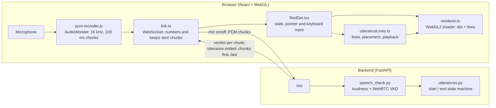
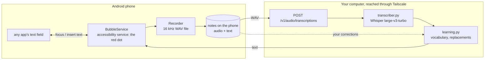

# RedDot


**RedDot is a frontend for voice input.** Hold the red dot and speak: the dot reacts while it hears speech, and every finished utterance appears as a small wavy line next to it. Tap a line to hear the utterance again, drag lines and the dot around the screen.

The goal of the project is a **testbed for AI agents that process voice recordings**: speech-to-text engines, language models and agents that act on what was said. Each utterance is a self-contained recording, which makes it easy to send the same audio to several agents and **compare their results side by side**. The voice input, speech detection and utterance handling are in place; connecting and comparing agents is the next step (see [Roadmap](#roadmap)).

**RedDot on Android: dictation into any app.** The Android app in `android/` puts the red dot next to any text field on the phone, the way Wispr Flow does. Hold it, speak, let go: a RedDot server on your own computer transcribes the note with Whisper, and the text appears in the field. The server learns your names and jargon from your corrections. Everything runs on hardware you own, for free. See [The Android app and the transcription API](#the-android-app-and-the-transcription-api).

## Features

- **Push to talk:** hold the dot (mouse, finger or the `R` key) to record; let go to stop.
- **Live speech detection:** a backend judges every 100 ms of audio (loudness + WebRTC voice activity detection); the dot turns a more intense red, glows and moves faster while speech is heard.
- **Utterances:** the audio is cut into utterances at pauses (0.7 s of quiet), when you let go, or after 15 s.
- **Utterance lines:** each utterance becomes a wavy line next to the dot. Tap it to play it back, drag it to arrange your utterances.
- **Draggable dot:** pick up the dot while recording and move it around.
- **Full-screen WebGL:** the dot and lines are drawn by a fragment shader, on desktop and mobile.
- **Private by design:** recordings stay in the browser. The backend only judges the audio, and saves nothing unless debug recording is switched on.
- **Android voice bubble:** in any app, the red dot appears while the keyboard is open. Hold it and speak (or tap, speak, tap again), and the transcript is typed into the field.
- **Whisper on your own computer:** the backend transcribes notes with faster-whisper (`large-v3-turbo`: about 0.2 s for a 7 s note on an RTX 5070 Ti). It speaks OpenAI's transcription API, so other voice apps can use it too.
- **Learns your words:** a vocabulary list steers Whisper towards your spelling of names and jargon, and corrections you make in the app add to it.
- **Never loses a note:** the phone keeps every recording, and transcribes it later if the server can't be reached.

## Architecture



### How a recording travels

1. **Recording:** while the dot is held, the AudioWorklet `pcm-recorder.js` turns the microphone into 16 kHz, 16-bit mono PCM and hands over 100 ms chunks. `link.ts` sends each chunk over a WebSocket, numbers it, and keeps the last 60 seconds of chunks in memory.
2. **Speech detection:** for every chunk, the backend checks two things: is it loud enough (RMS), and does WebRTC's voice detector hear a voice in most of its 20 ms frames? It answers with a **verdict** (`speech: true/false`), which drives the dot's look.
3. **Utterances:** a small state machine in the backend turns the verdicts into utterances: 200 ms of speech starts one (plus 300 ms of audio from just before, so the first syllable isn't cut), 700 ms of quiet, letting go or 15 seconds end it.
4. **Lines:** when an utterance ends, the backend only sends the **numbers of the chunks** it consists of. The browser assembles the audio from the chunks it kept and attaches it to a new line. The audio never has to travel back, and the server stores nothing.
5. **Playback:** tapping a line plays its audio with the Web Audio API.

### The Android app and the transcription API



1. **Tap into a text field in any app.** When the keyboard opens, the red dot appears at the edge of the screen. An accessibility service draws it, as Wispr Flow's Android bubble does, because only accessibility services may see which field is focused in another app and write into it. Android's own answer to "which field has the focus?" isn't always enough: Jetpack Compose and web views can answer with their whole screen (RedDot 0.2.0 showed no dot in the Claude app), so `FieldFinder` also looks inside that view for the focused, editable element, reading only flags and class names. If the keyboard is open but no field can be seen at all, the dot still shows, and the words go to the clipboard to paste.
2. **Hold the dot and speak, then let go** (or tap, speak, tap again). The phone records 16 kHz mono WAV straight into a file and saves the note before any network call.
3. **The server transcribes it.** The note goes to the OpenAI-compatible `POST /v1/audio/transcriptions`. Whisper gets your vocabulary as hints, and replacements learned from your corrections are applied to its text.
4. **The text goes into the field** at the cursor: written into app fields, pasted into web pages (whose editors keep their own copy of the text). RedDot checks 0.4 s later that the field really changed and otherwise pastes, or leaves the text on the clipboard. If you switched apps meanwhile, it goes to the clipboard too.
5. **No server, no problem:** an unreachable server leaves the note waiting on the phone. It is transcribed automatically once there is a connection, and appears in RedDot's notes list.
6. **Correct a note in the app** and the server compares your version with Whisper's: misheard names become vocabulary, and a fix you make twice becomes an automatic replacement (`learning.py` explains the rules).

### The HTTP API (`/v1`, with `DICTATION_API=1`)

| Request | Body | Answer |
|---|---|---|
| `POST /v1/audio/transcriptions` | multipart: `file` (WAV, M4A, Ogg…), optional `language` (`en`, `vi`…), `prompt`, `response_format` (`json`, `text`, `verbose_json`), and RedDot's own `note_id` and `recorded_at` | `{"text", "id", "language", "duration", "model", "whisper_text", "seconds_taken"}` |
| `GET /v1/models` | | the Whisper model in use, in OpenAI's format |
| `GET /v1/vocabulary` | | `{"words": [...], "replacements": [{"heard", "meant"}]}` |
| `POST /v1/vocabulary` | `{"add": [...], "remove": [...], "remove_replacements": [...]}` | as `GET /v1/vocabulary` |
| `POST /v1/corrections` | `{"original", "corrected", "note_id"}` | `{"fixes", "new_words", "new_replacements"}` |

Other voice apps that accept a custom OpenAI endpoint can use `http://<server>:8090/v1` as their base URL. With the API on, `GET /healthz` also reports whether Whisper is loaded: `{"ok": true, "transcription": {"model", "ready", "device", "error"}}`.

### The protocol (WebSocket `/ws`)

| Direction | Message | Meaning |
|---|---|---|
| page → server | `{"type": "mic", "on": true \| false}` | the dot was pressed / released |
| page → server | binary, 3200 bytes | 100 ms of 16 kHz 16-bit mono PCM, only while pressed |
| server → page | `{"type": "verdict", "speech": bool, "rms": int}` | one per chunk |
| server → page | `{"type": "utterance", "event": "ended", "first": n, "last": m, "seconds": s}` | an utterance consists of the chunks numbered `first..last` (counted from 1 per connection) |

`GET /healthz` answers `{"ok": true}`; the page polls it while the backend is unreachable before opening the WebSocket (Firefox slows down repeated failed WebSocket attempts).

### Repository layout

```
red-dot/                              the React app (Vite, TypeScript)
├── public/pcm-recorder.js            AudioWorklet: microphone -> 100 ms PCM chunks
├── vite.config.ts                    dev proxy: /ws and /healthz -> backend on :8090
└── src/components/RedDotCode/
    ├── RedDotPage.tsx                full-screen page
    ├── RedDot.tsx                    the component: state, input, animation loop
    ├── looks.ts                      the dot's and the lines' look (design them here)
    ├── renderer.ts                   WebGL2: one full-screen shader draws everything
    ├── utteranceLines.ts             utterance lines: placement, hit testing, playback
    ├── link.ts                       WebSocket, microphone, chunk store, recordings
    ├── useVoiceLink.ts               React hook around link.ts
    └── redDotServer/                 the backend (FastAPI)
        ├── server.py                 /healthz and /ws, origin check, logging
        ├── speech_check.py           is this 100 ms chunk speech?
        ├── utterances.py             cuts the stream into utterances
        ├── dictation_api.py          /v1: transcription, vocabulary, corrections (DICTATION_API=1)
        ├── transcriber.py            Whisper (faster-whisper), loaded once
        ├── learning.py               vocabulary, replacements, learning from corrections
        ├── tests/                    pytest: the learning rules and the Whisper prompt
        ├── requirements.txt
        └── requirements-gpu.txt      CUDA libraries for Whisper on an NVIDIA GPU
android/                              the Android app (Kotlin, Jetpack Compose)
└── app/src/main/java/io/github/kdiep12/reddot/
    ├── bubble/BubbleService.kt       accessibility service: the dot over other apps, text into fields
    ├── bubble/BubbleView.kt          the dot: drawing, hold / tap / drag
    ├── bubble/FieldFinder.kt         finds the field you type in: classic views, Compose, web pages
    ├── bubble/TextInserter.kt        puts the transcript into that field, and checks it arrived
    ├── audio/Recorder.kt             microphone -> 16 kHz WAV file
    ├── notes/Note.kt                 the notes on the phone, one folder each
    ├── net/ServerClient.kt           the /v1 HTTP API
    ├── Dictation.kt                  record -> save -> transcribe
    ├── TranscribeWorker.kt           transcribes waiting notes once there is a network
    └── ui/                           setup, the big dot, the notes, settings, words
docs/screenshot.png
```

### Design decisions

- **React renders the canvas once; the animation runs outside React.** 60 frames and 10 verdicts per second live in refs, not in React state, so they never cause re-renders.
- **One shader draws everything.** For each pixel it computes the distance to the dot's (wobbling) edge and to every line's wave. The looks are plain numbers in `looks.ts`.
- **The backend decides, the browser keeps the audio.** Speech detection runs in one place, so every client is judged the same way, while recordings stay on the device.
- **Only your own page may connect.** CORS covers `/healthz`, an explicit `Origin` check covers the WebSocket (`ALLOWED_ORIGINS`).

## Running it locally

**Requirements:** Node.js 22 or newer (developed with 24) and Python 3.10 or newer (developed with 3.12). Microphone access works on `http://localhost` and on `https://` pages.

### 1. Install

```bash
cd red-dot && npm install
cd src/components/RedDotCode/redDotServer && python3 -m venv .venv && .venv/bin/pip install -r requirements.txt
```

### 2. Start the backend (terminal 1)

```bash
cd red-dot/src/components/RedDotCode/redDotServer && .venv/bin/uvicorn server:app --port 8090
```

The terminal shows one log line per 100 ms chunk while you talk, and every utterance. Locally, each utterance is also saved as a WAV file in `debug-audio/` (see [Configuration](#configuration)).

### 3. Start the frontend (terminal 2)

```bash
cd red-dot && npm run dev
```

Open **http://localhost:5173**. Use `localhost`, not `127.0.0.1`: the backend only accepts the origins listed in `ALLOWED_ORIGINS`.

### 4. Test it

1. The dot is **red** (connected); grey means the page can't reach the backend.
2. **Hold the dot and say a sentence.** The backend logs `SPEECH`, the dot turns a more intense red and moves faster.
3. **Let go or pause:** the backend logs `utterance ended`, and a wavy line appears below the dot.
4. **Tap the line:** you hear your sentence; the line turns white while it plays.
5. **Drag the line and the dot** around the screen; they stay on screen.
6. **Hold `R`** to record without moving the dot.

`npm run build` type-checks the frontend (`tsc -b`) before building, and `npm run lint` runs the linter. The backend's learning rules have tests: `cd red-dot/src/components/RedDotCode/redDotServer && .venv/bin/python -m pytest tests`.

### 5. The Android app

**The server.** Install the transcription libraries, then start the backend with the API on:

```bash
cd red-dot/src/components/RedDotCode/redDotServer
.venv/bin/pip install -r requirements.txt -r requirements-gpu.txt   # requirements-gpu.txt: NVIDIA GPUs only
DICTATION_API=1 WHISPER_PRELOAD=1 .venv/bin/uvicorn server:app --host 0.0.0.0 --port 8090
```

The first start downloads Whisper `large-v3-turbo` (1.6 GB). Without an NVIDIA GPU it runs on the CPU; set `WHISPER_MODEL=small` there for speed.

**The network.** Install [Tailscale](https://tailscale.com) on the computer and on the phone, signed in to the same account. The phone then reaches the server at the computer's Tailscale address (`tailscale ip -4`), wherever both are. Tailscale encrypts the connection, and only your own devices get in. Without Tailscale, on the same Wi-Fi, use the computer's LAN address and set `DICTATION_TOKEN`, because LAN addresses aren't in `DICTATION_NETWORKS`.

**Build the app.** You need JDK 17 or newer and the Android SDK, either from Android Studio or the command-line tools with `platforms;android-36` and `build-tools;35.0.0`. The app targets Android 16 (API 36), which Google Play requires:

```bash
cd android
echo "sdk.dir=$HOME/Android/Sdk" > local.properties
echo "reddot.serverUrl=http://100.x.y.z:8090" >> local.properties   # optional: your server, pre-filled in the app
./gradlew assembleRelease     # app/build/outputs/apk/release/app-release.apk
./gradlew bundleRelease       # app/build/outputs/bundle/release/app-release.aab, for Google Play
```

Without `keystore.properties` (see `app/build.gradle.kts`), release builds are signed with your debug key. Keep signing with the same key, because Android only installs an update over an app signed with the same key.

**Install it.** No Play Store needed: copy the APK to the phone and open it (Android asks you to allow installing from that app), or run `adb install app-release.apk`.

A phone managed by an employer often blocks apps from outside the Play Store, even on its personal side ("blocked by your IT admin"). There, RedDot has to come from Google Play: upload the `.aab` as a private internal test, which needs a Google Play developer account (US$25 once) and is visible only to the testers you invite. Google asks apps with an accessibility service for a declaration and a short video of the in-app explanation below.

**Set it up on the phone.** Open RedDot and follow "Set up RedDot": the server check, the microphone, and the voice bubble. Its Accessibility button first explains what the bubble sees and does; Agree opens Android's Accessibility settings, where you turn on RedDot voice bubble. Android blocks accessibility settings for apps installed from a file. If the switch is greyed out, open App info, tap ⋮, choose **Allow restricted settings**, and try again.

**Test it** (with a real phone and microphone):

1. Open any app with a text field, such as Messages, Claude or a notes app, and tap into the field. When the keyboard opens, the red dot appears at the right edge.
2. Hold the dot, say a sentence and let go. One buzz marks the start and two the stop. The dot shows a turning arc while the server transcribes, then a check mark, and the text is in the field.
3. Tap the dot, speak, and tap again: the same, hands-free.
4. Drag the dot to move it. It remembers the place.
5. Turn on airplane mode, dictate, and turn it off again. The note waits in RedDot's list and is transcribed once the server is reachable.
6. In RedDot, open a note, correct a misheard name and save. RedDot tells you which words it learned. Dictate the name again.

**Without a phone,** the Android emulator works too (tested with Android 15 and 16 images), and `android/e2e/inject_audio.py` plays a recording into its microphone (it needs `pip install grpcio grpcio-tools` and ffmpeg). Start recording before you play: the Android 16 emulator (version 37.2) crashes when audio arrives while no app is recording.

```bash
emulator -avd <your AVD> -grpc 8554 &
adb install app/build/outputs/apk/debug/app-debug.apk
adb shell pm grant io.github.kdiep12.reddot android.permission.RECORD_AUDIO
adb shell settings put secure enabled_accessibility_services io.github.kdiep12.reddot/io.github.kdiep12.reddot.bubble.BubbleService
adb shell am start -a android.intent.action.VIEW -d 'reddot://setup?server=http%3A%2F%2F10.0.2.2%3A8090'   # 10.0.2.2: this computer, seen from the emulator
adb shell input swipe X Y X Y 9000 & sleep 1; python3 e2e/inject_audio.py note.wav 0.4                     # X Y: where the dot is; holds it for 9 s, then plays
```

## Configuration

**Backend** (environment variables):

| Variable | Default | Meaning |
|---|---|---|
| `ALLOWED_ORIGINS` | `http://localhost:5173` | comma-separated list of origins whose pages may connect, e.g. `https://example.com` |
| `DEBUG_AUDIO_DIR` | `debug-audio` | where every utterance is saved as a WAV file; **empty: save nothing** (use that in production) |
| `VAD_MIN_RMS` | `200` | how loud a chunk must be to count as speech (16-bit scale; speech is typically 1000–5000) |
| `VAD_MODE` | `3` | WebRTC VAD strictness, 0 (lenient) to 3 (strictest) |
| `DICTATION_API` | `0` | `1`: switch on the `/v1` HTTP API, the transcription for the Android app |
| `DICTATION_NETWORKS` | `127.0.0.0/8,::1/128,100.64.0.0/10,fd7a:115c:a1e0::/48` | client addresses that may use `/v1` without a token: this machine and Tailscale's ranges. **Behind a reverse proxy** every client looks like `127.0.0.1`: set it to empty and use a token |
| `DICTATION_TOKEN` | empty | a secret that lets any client use `/v1`, sent as `Authorization: Bearer <token>` |
| `DICTATION_DATA_DIR` | `dictation-data` | vocabulary, replacements, corrections, and kept notes |
| `DICTATION_KEEP_AUDIO` | `0` | `1`: keep every note's audio and text in `DICTATION_DATA_DIR/notes/`, to tune Whisper to your voice later. **Personal voice recordings** |
| `WHISPER_MODEL` | `large-v3-turbo` | any faster-whisper model, e.g. `small`, `medium`, `large-v3` |
| `WHISPER_DEVICE` | `auto` | `cuda`, `cpu`, or `auto`: the GPU if there is one, otherwise the CPU |
| `WHISPER_COMPUTE_TYPE` | `default` | `float16` on a GPU and `int8` on a CPU, unless set |
| `WHISPER_PRELOAD` | `0` | `1`: load Whisper at startup, so the first note isn't slow |

**Frontend** (build time): `VITE_BACKEND_URL` in `red-dot/.env.production`, the backend's public address, e.g. `https://api.example.com`. Leave it unset for development: the page then uses its own address and Vite's proxy forwards `/ws` and `/healthz` to `localhost:8090`.

## Deployment

The frontend is a static site; the backend is a small Python service behind a reverse proxy. Two (sub)domains, both with HTTPS (browsers only allow the microphone on secure pages), for example `example.com` for the page and `api.example.com` for the backend.

### Backend

1. Copy `red-dot/src/components/RedDotCode/redDotServer/` to the server (without `.venv`, `__pycache__`, `debug-audio`), create the environment there and install `requirements.txt`.
2. Run it permanently, only reachable from the server itself, e.g. with a systemd unit:

   ```ini
   [Unit]
   Description=RedDot speech detector
   After=network.target

   [Service]
   User=reddot
   WorkingDirectory=/home/reddot/redDotServer
   Environment=ALLOWED_ORIGINS=https://example.com
   Environment=DEBUG_AUDIO_DIR=
   ExecStart=/home/reddot/redDotServer/.venv/bin/uvicorn server:app --host 127.0.0.1 --port 8090
   Restart=always

   [Install]
   WantedBy=multi-user.target
   ```

3. Put a reverse proxy with HTTPS in front of it. For nginx, the WebSocket needs HTTP/1.1, the upgrade headers and a long timeout (the socket is silent while nobody talks):

   ```nginx
   location / {
     proxy_pass http://127.0.0.1:8090;
     proxy_http_version 1.1;
     proxy_set_header Upgrade $http_upgrade;
     proxy_set_header Connection "upgrade";
     proxy_set_header Host $host;
     proxy_read_timeout 3600s;
     proxy_send_timeout 3600s;
   }
   ```

4. Check: `curl https://api.example.com/healthz` answers `{"ok":true}`.

### A personal transcription server for the Android app

Run the backend on the computer with the GPU, reachable through Tailscale, as a systemd user service:

```bash
cd red-dot/src/components/RedDotCode/redDotServer
sh install_service                          # or: DICTATION_KEEP_AUDIO=1 sh install_service
```

`install_service` writes `~/.config/systemd/user/reddot.service` (the transcription API on port 8090, data in `~/.local/share/reddot`) and starts it. With `DICTATION_KEEP_AUDIO=1` the server also keeps every note's audio, for tuning Whisper to your voice later. Follow the log with `journalctl --user -u reddot -f`. User services stop when you log out, unless you run `loginctl enable-linger $USER` once. To remove it: `systemctl --user disable --now reddot && rm ~/.config/systemd/user/reddot.service`.

The service runs the code in this directory, so it follows the branch you have checked out: switch to a branch without the transcription API and the service fails to start.

### Frontend

1. Set the backend's address and build:

   ```bash
   cd red-dot && echo "VITE_BACKEND_URL=https://api.example.com" > .env.production && npm run build
   ```

2. Upload `red-dot/dist/` to the web server's document root.
3. Serve the files, and send unknown paths to `index.html` (React Router decides in the browser what to show). `index.html` should not be cached; the hashed files in `assets/` can be cached forever:

   ```nginx
   location / {
     try_files $uri $uri/ /index.html;
   }
   location = /index.html {
     add_header Cache-Control "no-cache";
   }
   location ^~ /assets/ {
     expires 1y;
     add_header Cache-Control "public, immutable";
   }
   ```

### Troubleshooting

| Symptom | Likely cause |
|---|---|
| The dot stays grey | backend not running; page origin not in `ALLOWED_ORIGINS` (backend log: `refused a WebSocket from ...`); right after a backend restart, wait a few seconds |
| WebSocket fails with HTTP 426 | the reverse proxy doesn't pass the upgrade: `proxy_http_version 1.1` and the `Upgrade` / `Connection` headers are missing |
| The connection drops every 60 s | the reverse proxy's read timeout is too short |
| "Could not start the microphone" | the page isn't served over HTTPS (or `localhost`), or microphone access was denied |
| No line after an utterance | the backend is an older version that doesn't send `utterance` messages |
| The app says "Can't reach the server" | Tailscale is off on the phone or the computer; the backend isn't running (`curl http://<address>:8090/healthz`); a firewall blocks port 8090 |
| HTTP 401, "Not allowed: connect through Tailscale" | the phone reaches the server by a LAN or public address: use the Tailscale address, or set `DICTATION_TOKEN` and enter it in the app |
| Installing the APK is "blocked by your IT admin" | the phone is managed by an employer, which can block installs from outside the Play Store on the personal side too: install RedDot from a private Google Play test instead (see "5. The Android app") |
| The bubble doesn't appear | the accessibility service is off (Android turns it off after the app crashes or is updated); the keyboard is closed while "Only while the keyboard is open" is on; it is a password field |
| The dot shows in other apps but not in one | tap into that app's text field, open RedDot's Settings and look at **Last text field** under Bubble: the app, the field's class, what Android reported as focused and how RedDot found the field (no text). "keyboard only" means RedDot can't see the field and puts your words on the clipboard. A screenshot of that line is what's needed to fix it |
| "The microphone gave RedDot only silence" | Android blocked the microphone: open RedDot and check the microphone permission |
| The text lands on the clipboard instead of in the field | the field doesn't accept text from accessibility services, RedDot can only see the keyboard there ("keyboard only" in Settings), or you switched apps while it was transcribing: paste it |
| Whisper fails with `libcublas.so.12 is not found` | `requirements-gpu.txt` isn't installed in `.venv` |

## Roadmap

- **Done, the first processor:** Whisper transcription behind an OpenAI-compatible endpoint, used by the Android app. `transcriber.py` is where the "processors" interface below can grow from.
- **Transcription on the phone** for places without signal: a small Whisper model on the device, with the server as the better fallback.
- **Whisper tuned to your voice,** trained on the kept notes and their corrections (`DICTATION_KEEP_AUDIO=1`).
- **Agents behind one interface.** Every finished utterance is a self-contained recording. The next step is a small interface for "processors" that take a recording and return a result (a transcript, a reply, an action), so that different speech-to-text engines (e.g. Google Cloud Speech-to-Text, Gemini, Whisper) and agents built on them can be plugged in and swapped without touching the UI.
- **Side-by-side comparison.** Send the same utterance to several processors at once and show their results, timings and confidence next to its line.
- **Speech detection in the browser.** Running voice activity detection locally (e.g. Silero VAD in WebAssembly) would make the dot react instantly and keep audio on the device, with the backend only needed for the agents.
- **Persistence.** Lines currently live in the page and disappear on reload.

## Privacy

**The web page:** recordings stay in the browser's memory and are gone when the page is closed. The backend receives the audio only to judge it chunk by chunk; it doesn't store it unless `DEBUG_AUDIO_DIR` is set, which is the default for local development only. Set `DEBUG_AUDIO_DIR=` (empty) on any server other people use.

**The Android app:** notes, both audio and text, stay on the phone until you delete them. Each note's audio goes to the RedDot server you set up, and nowhere else. The accessibility permission tells the app when you move into a text field in any app, and lets it see that field and its text, the name of its app and whether the keyboard is showing, and write into the field. To find the field it may look at which element of the app's screen has the keyboard's focus, reading only each element's flags and class name. It doesn't read anything else written on the screen or send anything from it, and it stays out of password fields. Settings' "Last text field" line shows what it found, without any text. The app explains this and asks before it opens Android's setting.

**The transcription server** (`DICTATION_API=1`) receives whole notes, transcribes them in memory and returns the text. It keeps your vocabulary, your replacements and every correction you send, which is text, in `DICTATION_DATA_DIR`. It keeps audio only with `DICTATION_KEEP_AUDIO=1`. `DICTATION_DATA_DIR/notes/` then holds personal voice recordings: never commit, upload or share them. The log records lengths and timings, not what was said.
